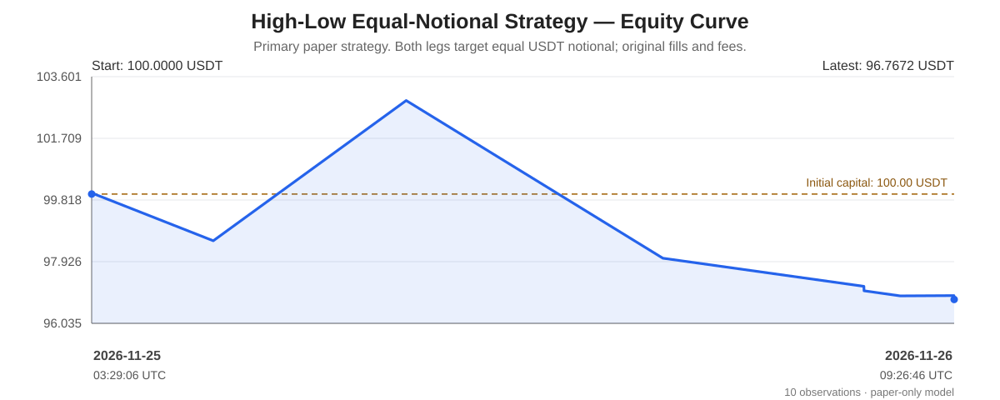
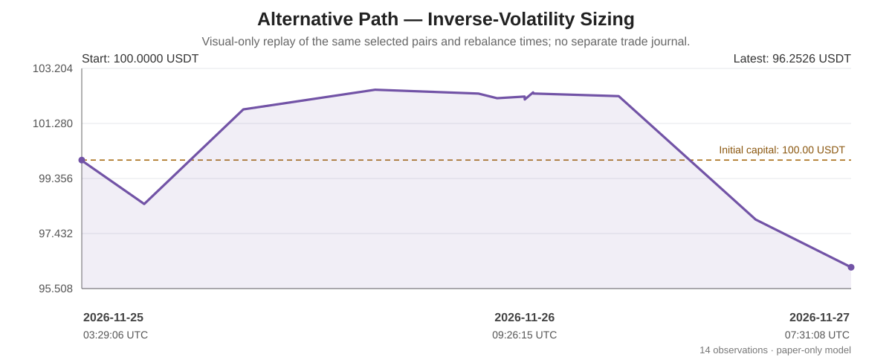

# ACTIVE PAPER STATUS — HIGH-LOW $100 USDT

**🟢 ACTIVE · PAPER ONLY · NO LIVE ORDERS**

**Correct workflow:** [Open active workflow](https://github.com/takenthatusernameis-collab/high-vs-low/actions/workflows/high-low-paper-cycle.yml)

- Account: `mexc-usdt-forward-high-low-100usdt-v1`
- Strategy generation: `high-low-ath-atl-cross-sectional-v1-100usdt`
- Starting capital: **100.00000000 USDT**
- Account state: **INITIALIZED — FORWARD PAPER**
- Last report build: 2026-11-27 18:56:25 UTC
- Latest workflow run: [46053027661](https://github.com/takenthatusernameis-collab/high-vs-low/actions/runs/46053027661) · run #16, attempt 1 · success · schedule
- Latest processed daily candle: 2026-11-26 00:00:00 UTC
- Latest account event: 2026-11-27 18:56:08 UTC
- Primary execution journal: [PAPER_TRADE_JOURNAL.md](PAPER_TRADE_JOURNAL.md)

## Current performance

| Metric | Value |
|---|---:|
| Initial capital | 100.00000000 USDT |
| **NAV** | **90.56311514 USDT** |
| Total return | -9.437% |
| Cash | 92.14201514 USDT |
| Unrealized P&L | -1.57890000 USDT |
| Fees paid | 0.19648486 USDT |
| Confirmed funding | +0.00000000 USDT |
| Gross exposure | 2.024× NAV |
| Net exposure | 0.017× NAV |
| Current drawdown from risk-window peak | -1.613% |
| Lifetime / cross-session maximum drawdown | -11.962% |
| Worst risk-session maximum drawdown | -4.701% |
| Sharpe ratio | Unavailable — At least 30 daily returns are required |
| Sortino ratio | Unavailable — Requires at least 20 daily returns and 5 negative daily returns |
| Annualized daily volatility | Unavailable — At least 30 daily returns are required |

### Maximum drawdown by risk session

| Session start (UTC) | Starting NAV | Latest NAV | Max drawdown | Marks |
|---|---:|---:|---:|---:|
| 2026-11-25 00:00:00 UTC | 100.00000000 | 100.00000000 | +0.000% | 1 |
| 2026-11-25 03:29:24 UTC | 100.03187864 | 98.03257864 | -4.701% | 4 |
| 2026-11-26 00:00:00 UTC | 97.17007864 | 97.17007864 | +0.000% | 1 |
| 2026-11-26 06:18:57 UTC | 97.03328978 | 96.92228978 | -0.274% | 7 |
| 2026-11-27 00:00:00 UTC | 92.29388978 | 92.29388978 | +0.000% | 1 |
| 2026-11-27 01:04:07 UTC | 92.04761514 | 90.56311514 | -1.613% | 4 |

## Open positions

| Symbol | Side | Quantity | Entry price | Mark | Notional (USDT) |
|---|---|---:|---:|---:|---:|
| TAKEDASTOCK_USDT | long | 1.97 | 46.75065989847715736040609137 | 46.14 | 90.895800 |
| MITSUBISHISTOCK_USDT | short | 5.37 | 17.14 | 17.21 | 92.417700 |

## Primary path — equal exposure

The live forward-paper strategy sizes the long and short legs independently toward equal USDT notional (approximately 1× NAV per leg before lot rounding).

## Alternative path — volatility-weighted sizing

This chart is a **visual-only counterfactual**, not an executed account. It reuses the primary strategy’s exact selected symbols, sides and rebalance timestamps; only the notional split changes. No alternative trade journal is created.

At each rebalance, the quieter leg receives the larger share using inverse 30-completed-day realized volatility. The leverage overlay is the ratio of equal-exposure pair volatility to the inverse-volatility pair’s base estimated volatility. It increases modeled gross exposure only when the alternative has lower estimated volatility. Estimates use only data available at that rebalance.

- Latest long / short allocation: **59.0% / 41.0%** of alternative gross notional.
- Latest volatility-matching leverage multiplier: **1.047×**.
- Estimated base volatility reduction before leverage: **+4.48%**.
- Volatility observations used: **30**; status: `RISK_MATCHED_INVERSE_VOLATILITY`.

**Model limitations:** the counterfactual scales observed primary entry/exit fees and funding by shadow notional. It does not model additional nonlinear market impact, depth constraints, liquidation limits or exchange leverage caps for larger hypothetical exposure. It is not an executable leverage recommendation.

## Next workflow action

The next daily decision requires a newer completed UTC candle and a passing data-coverage gate.

The daily-candle watermark is not advanced by this report. Only the paper workflow can consume a completed candle after full-history and execution gates pass. A blocked or incomplete run remains visible.

## Historical separation

The v3 $50 USDT generation and its preliminary snapshots are archived and excluded from this account’s NAV, returns, equity curves and metrics. The immutable event ledger remains intact.

## Alternative-path reconstruction notes

- No reconstruction warnings.

This is the compact live status page. The former detailed v3 report is retained under `archive/2026-11-18/` for audit purposes only.
